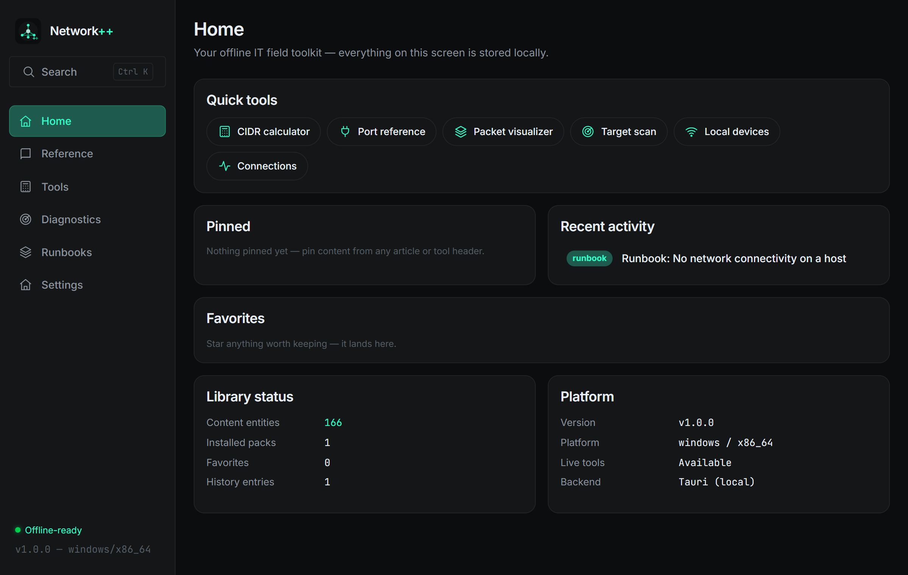

<a name="readme-top"></a>

<div align="center">


# Network++

### Offline-first IT Field Toolkit

A comprehensive toolkit for IT, network, OS, security and infrastructure
professionals — technical knowledge, practical tools, diagnostics and
operational guides, usable **without an internet connection**.

[](https://github.com/IzumiRain/Network_PP/releases)
[](#-license)
[](#-platforms)
[](https://tauri.app)
[](#-development)

[Report a Bug](https://github.com/IzumiRain/Network_PP/issues) ·
[Request a Feature](https://github.com/IzumiRain/Network_PP/issues) ·
[Content Packs](docs/PACK-SPEC.md)



</div>

---

## 📋 About

Most networking work is split between heavy GUI suites and scattered CLI
one-liners. Network++ puts the daily-use parts into one small, native,
offline app that runs on weak hardware:

- **Reference** — a searchable knowledge base built from content packs
  (commands, protocols, errors, standards, vendor CLI references)
- **Tools** — subnet/CIDR math, IPv6, port lookup, bandwidth/MTU,
  converters, generators, JSON/regex/diff utilities
- **Packet Lab** — build packets field-by-field, parse hex dumps, read
  classic `.pcap` captures — checksums computed for real
- **Diagnostics** — TCP scanning with banner grabbing, local device
  discovery (ARP + vendor OUI), ping sweeps, a **pure-Rust DNS client**,
  HTTP probes, system info and exportable diagnostic sessions
- **Runbooks** — step-by-step operational guides with persisted progress

Everything computes locally. Nothing leaves the machine.

## ✨ Key features

<details open>
<summary><b>Calculators & converters</b></summary>

- **CIDR & IP range** — network/broadcast/host range, wildcard mask, class &
  type, subnet splitting, range→CIDR, membership check — live as you type
- **IPv6** — RFC 5952 compression/expansion, prefix math, type detection,
  EUI-64 from a MAC
- **Performance** — transfer time, MTU→MSS, per-packet overhead efficiency
- **Converters** — number systems, IPv4 ↔ int/binary/hex, MAC formats
  (Cisco/Windows/bare), Base64, URL, text↔hex, Unix ↔ ISO 8601 timestamps
- **Generators** — UUID v4, random MAC/IPv4, passwords, SHA-256/512
- **Text & data** — JSON formatter, regex tester, LCS line diff, case &
  whitespace tools

</details>

<details open>
<summary><b>Packet Lab</b></summary>

- **Build (live)** — edit Ethernet/IPv4/TCP fields and watch the bytes
  update, with real IPv4 + TCP checksum computation
- **Parse hex** — paste a hex dump, read every layer:
  Ethernet / IPv4 / IPv6 / TCP / UDP / ICMP / HTTP
- **PCAP reader** — classic pcap (both byte orders, µs/ns), per-packet
  L2/L3/L4 summaries

</details>

<details open>
<summary><b>Diagnostics</b></summary>

- **Target scan** — nmap-style TCP connect scan with concurrency, banner
  grabbing, service names
- **Local devices** — ARP table with vendor identification, TCP host
  discovery, system ping sweep
- **DNS** — A/AAAA/CNAME/MX/NS/TXT/SOA/SRV lookups against any resolver,
  resolver comparison, RCODE reporting — built on a **pure-Rust DNS client**
  (query wire format + compression-pointer parsing, no external tools)
- **HTTP probe** — status class, timing, headers, proxy-aware
- **System** — host info, disks, top processes
- **Sessions** — group tests per problem, record results with timestamps,
  export a clean Markdown report

</details>

<details open>
<summary><b>Reference & content packs</b></summary>

- Nine content templates (command / protocol / vendor / tool / runbook /
  error / port / configuration / standard) with **risk classification** and
  versioning
- Bundled **core pack: 166 entities** — Linux, Windows, Splunk SPL, security
  standards, runbooks
- 15 downloadable packs / 227 entities in the community registry —
  FortiGate, Cisco ASA, F5 BIG-IP, FortiWeb, FortiAuthenticator, WAF
  (ModSecurity/CRS), Splunk operations, Security+ / OWASP Top 10 / signature
  types, ISO/IEC standards, Juniper, MikroTik, Palo Alto, pfSense/OPNsense,
  Check Point/Sophos, Proxmox/Docker/Kubernetes, AWS/Azure/GCP
- SHA-256-verified installs, offline file import, SOCKS5/HTTP proxy support,
  jsDelivr-friendly registry
- **Global search (Ctrl+K)** over SQLite FTS5, favorites, pin-to-home,
  history, interactive runbooks

</details>

## 🖥️ Platforms

| | Windows | Linux | Android |
|---|---|---|---|
| Reference, Runbooks, search, packs | ✅ | ✅ | ✅ |
| Calculators, converters, packet lab | ✅ | ✅ | ✅ |
| Scanning, local devices, connections | ✅ | ✅ | ➖ |
| Raw packet capture (planned) | 🔜 | 🔜 | ➖ |

<p align="right">(<a href="#readme-top">back to top</a>)</p>

## 🚀 Getting started

Prerequisites: **Rust** (stable, MSVC on Windows), **Node.js 20+**,
WebView2 (preinstalled on Windows 10/11).

```bash
git clone https://github.com/IzumiRain/Network_PP.git
cd Network_PP
npm install
npm run tauri dev      # desktop shell with hot reload
npm run tauri build    # release build + installer
```

Installers are attached to each [release](https://github.com/IzumiRain/Network_PP/releases)
(Windows NSIS ~2.8 MB, Linux deb/AppImage).

### Content packs

```bash
# in the app: Settings → Content packs → set registry URL
https://raw.githubusercontent.com/IzumiRain/Network_PP_addons/main/index.json
```

Author your own pack with **[docs/PACK-SPEC.md](docs/PACK-SPEC.md)** — a
pack is a zip of Markdown files; no code required.

## 🧪 Development

```bash
cargo test                 # Rust unit tests (src-tauri)
cargo clippy --all-targets # must be warning-free (CI enforces -D warnings)
npm run typecheck          # strict frontend typecheck
```

Architecture: **Rust + Tauri 2** backend, **vanilla TypeScript** frontend
(no framework, ~70 KB JS), SQLite/FTS5 local store. Design contract in
[docs/DESIGN.md](docs/DESIGN.md), product definition in
[docs/PRODUCT.md](docs/PRODUCT.md).

## 🗺️ Roadmap

- [x] 0.2 — product foundation: IA, content engine, packs, global search
- [x] 0.3 — tool expansion (IPv6, converters, generators, text tools)
- [x] 0.4 — diagnostics suite (DNS client, HTTP probes, sessions)
- [x] 0.5 — PCAP reading + interactive runbooks
- [x] 1.0 — first stable release
- [x] 1.1 — vendor-first Reference taxonomy + registry categories
- [x] 1.2 — in-app update checker, factory reset
- [ ] 1.x — raw packet capture (`capture` feature, Npcap/libpcap), pcapng
- [ ] 1.x — Android build release, monitoring pack (ELK/Prometheus)

See the full history in [docs/releases](docs/releases).

<p align="right">(<a href="#readme-top">back to top</a>)</p>

## 🤝 Contributing

Two paths: **content packs** (Markdown, no code — see
[CONTRIBUTING.md](CONTRIBUTING.md)) and code (Rust/TypeScript, tests
required). Content is never duplicated — one ID per fact, referenced
everywhere.

## ⚖️ License

Distributed under the **PolyForm Noncommercial 1.0.0** with additional
terms (lawful use only, no malicious use). See
[LICENSE](LICENSE). Commercial licensing: contact the maintainer.

> [!WARNING]
> Use Network++ only on networks and systems **you own or are explicitly
> authorized to test**. Unauthorized scanning is illegal in most
> jurisdictions and prohibited by the license.

For security vulnerabilities, see [SECURITY.md](SECURITY.md).

<p align="right">(<a href="#readme-top">back to top</a>)</p>
