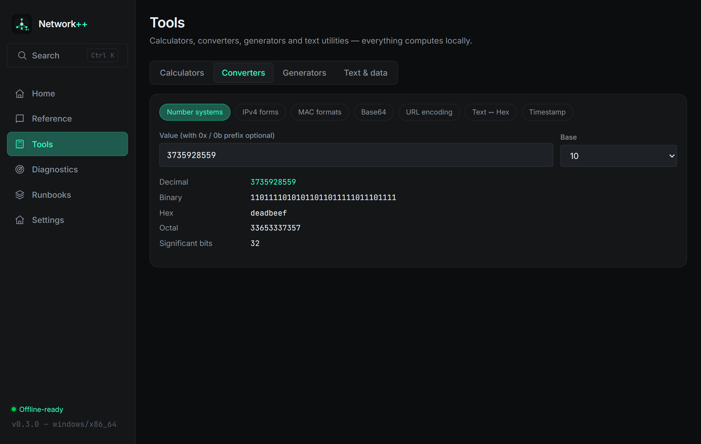

# Network++ 0.3.0 — Tool expansion

**Date:** 2026-11-07 · **Tag:** `v0.3.0` · **Installer:** ~2.5 MB

Tools grows from 3 panels to **5 groups / 11 interactive tools**, all computing
locally through the Rust backend.

## New tools

### IPv6 calculator (`Tools → Calculators → IPv6`)
- RFC 5952 compression & full expansion, `/prefix` aware
- Network / first / last address, total count, address type detection
  (global, ULA, link-local, multicast, IPv4-mapped, loopback…)
- Full binary representation
- **EUI-64** interface identifier from a MAC (U/L bit flipped correctly)

### Performance calculators (`Tools → Calculators → Performance`)
- Transfer time: any size (byte → GB) over any link speed
- MTU → TCP MSS, UDP payload max, ping test sizes
- Per-packet overhead: efficiency % of Ethernet+IPv4+TCP framing, packet
  count and total wire bytes for a payload

### Converters (`Tools → Converters`)
- Number systems: decimal / binary / hex / octal, any direction
- IPv4 forms: dotted ↔ integer ↔ binary ↔ hex
- MAC formats: normalized / Windows / Cisco dotted / bare, OUI + NIC split
- Base64 encode/decode · URL encode/decode · Text ↔ Hex
- Timestamps: Unix ↔ ISO 8601 (pure-Rust civil date math, no chrono)

### Generators (`Tools → Generators`)
- UUID v4 (1–50 at a time, crypto-random)
- MAC addresses (locally-administered, unicast)
- IPv4 addresses (public or RFC 1918 pools)
- Passwords (8–128 chars, mixed classes guaranteed, shuffled)
- SHA-256 + SHA-512 hashes of any text

### Text & data (`Tools → Text & data`)
- JSON formatter/validator with live error position
- Regex tester: matches, positions, capture groups
- Line diff (LCS): colored +/− output
- Case converter (camel/pascal/snake/kebab/title/upper/lower) +
  whitespace cleaner

## Critical fix

**Tauri v2 invoke bridge** — the global-bridge used `window.__TAURI__.invoke`
(Tauri v1 shape). v2 exposes it under `__TAURI__.core.invoke`, so every live
tool returned "browser preview" errors in the packaged app since 0.1.
Caught by capturing the real window over CDP; fixed and verified live.

## Under the hood

- New backend modules: `ipv6`, `calc`, `convert`, `generate`, `texttools`
  (+ 26 new Tauri commands, all std-first, no heavy dependencies)
- New crates: `uuid`, `getrandom`, `regex` — all pure Rust
- **77/77 unit tests** (26 new)
- Playwright UI audit: mobile overflow of segmented controls found & fixed;
  all 22 view/viewport combos clean

## Verification

| Check | Result |
|---|---|
| Rust tests | 77/77 |
| UI audit (2 viewports × 11 views) | clean |
| Release build | `Network++_0.3.0_x64-setup.exe` |

