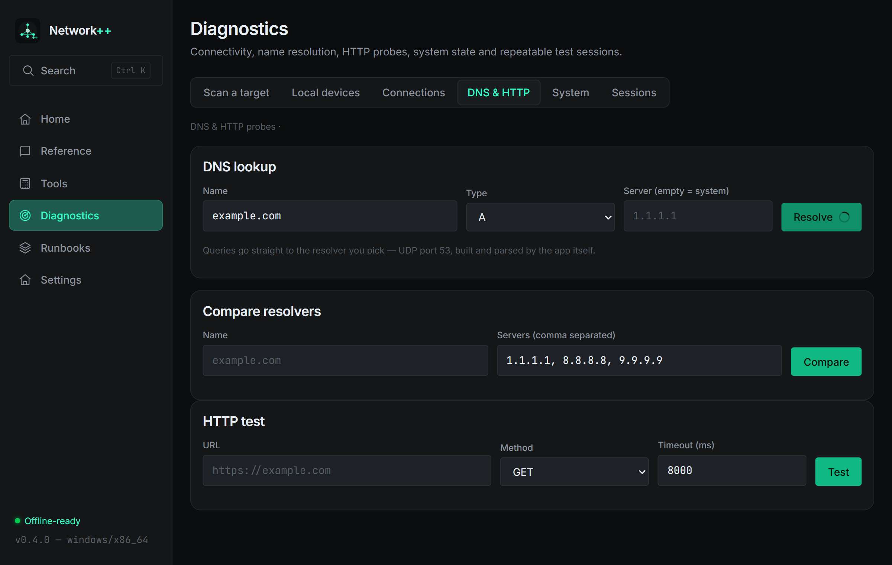

# Network++ 0.4.0 — Diagnostics suite

**Date:** 2026-11-07 · **Tag:** `v0.4.0` · **Installer:** ~2.8 MB

Diagnostics grows from 3 tabs to **6**: scan target · local devices ·
connections · **DNS & HTTP** · **System** · **Sessions**.

## New: real DNS client (pure Rust)

The app now speaks DNS itself — query building, UDP transport and response
parsing with compression-pointer handling, no system tools involved.

- Lookup: A / AAAA / CNAME / MX / NS / TXT / SOA / SRV against any resolver
- Response time, RCODE reporting (NOERROR, NXDOMAIN, SERVFAIL, REFUSED…)
- **Resolver comparison**: fire the same query at several servers and see
  who answers, how fast, and whether the answers differ
- New module `dns.rs` with wire-format unit tests (synthetic response bytes,
  pointer jumps, id/QR validation)

## New: HTTP probe

GET/HEAD against any URL — status class pill, total time, body size, server,
content-type and the full header table. Honors the configured proxy from
Settings → Content packs. Non-2xx is reported honestly (it is a completed
exchange), transport failures show as errors.

## New: System diagnostics

- Hostname, user, OS/arch, CPU cores, app version
- Disk volumes with used-percentage
- Top processes by memory (tasklist/ps parsed per platform)

## New: Diagnostic sessions

The workflow tool for field work: create a session for one problem, run
**ping / TCP port / DNS / HTTP** tests straight into it (each result is
recorded with timestamp and outcome), keep notes, then **export the whole
session as a clean Markdown report** (pipe-escaped table, ready to paste
into a ticket). Sessions persist in SQLite; deleting a session cascades its
results.

## Under the hood

- New modules: `dns`, `httptest`, `sysinfo`, `sessions` (+14 commands)
- `sessions` extends `Store` with a second `impl` block; new tables
  `sessions` / `session_results` with ON DELETE CASCADE
- **88/88 unit tests** (11 new, including DNS wire-format and session
  lifecycle/cascade/escaping)
- `save_text_file` command added for report export

## Verification

| Check | Result |
|---|---|
| Rust tests | 88/88 |
| Release build | `Network++_0.4.0_x64-setup.exe` |

