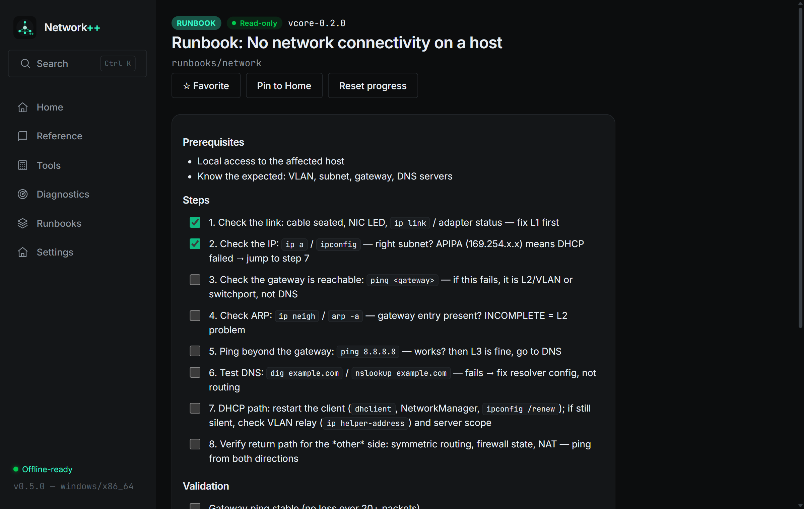

# Network++ 0.5.0 — PCAP reader & interactive runbooks

**Date:** 2026-11-07 · **Tag:** `v0.5.0` · **Installer:** ~2.8 MB

## New: PCAP file reading (`Tools → Packet lab → PCAP file`)

- Opens classic **pcap** captures (libpcap/tcpdump/Wireshark "save as pcap"),
  both byte orders, micro- and nanosecond resolution — pure Rust parser with
  no libpcap dependency
- File metadata: version, link type, duration, snaplen; packet table with
  timestamps, sizes and live **L2/L3/L4 summaries** (the same packet parser
  that powers the visualizer decodes every row)
- Fully local: the file never leaves the machine; 64 MB guard; pcapng
  detected and reported clearly (support lands later)
- A sample capture ships in the repo at `docs/samples/sample.pcap`

## New: interactive runbooks (`Runbooks` → open any runbook)

- Checkboxes now **persist per runbook** in SQLite — close the app mid-run,
  come back, your progress is still there (350 ms debounce on every toggle)
- "Reset progress" action on every runbook
- This is the v1 of the runbook engine: stateful steps, saved notes and
  session-linked runbooks follow in 1.x

## Under the hood

- New modules: `pcap` (reader + tests over all four byte-order/format
  combinations), `progress` (per-entity runbook state)
- New commands: `pcap_parse_file`, `rb_progress_get/set/clear`,
  `save_text_file`
- **93/93 unit tests** (5 new: pcap formats, truncation guard, progress
  roundtrip and isolation)

## Verification

| Check | Result |
|---|---|
| Rust tests | 93/93 |
| Release build | `Network++_0.5.0_x64-setup.exe` |

