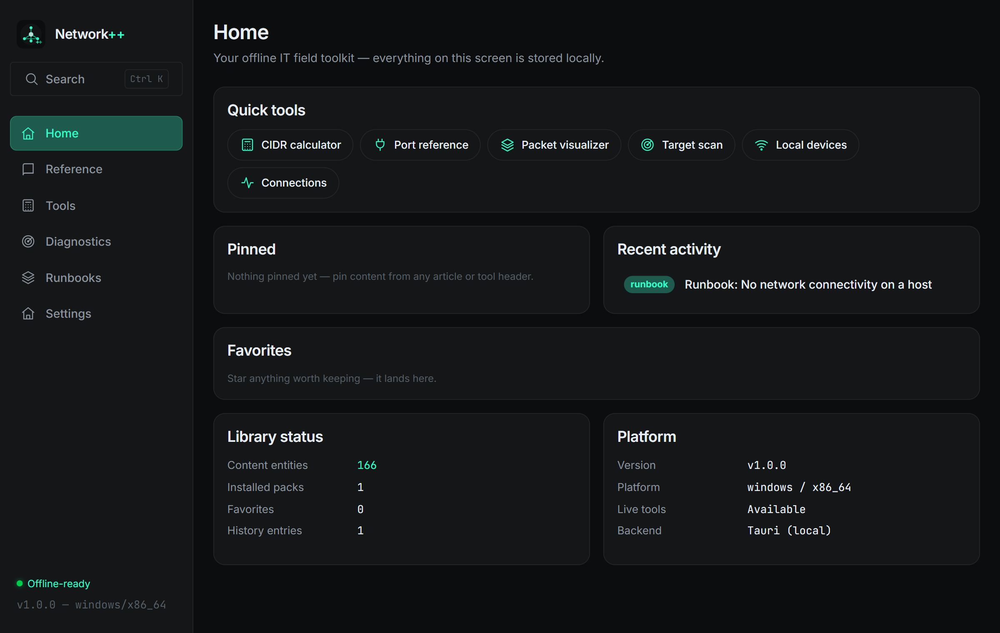

# Network++ 1.0.0 — first stable release

**Date:** 2026-11-07 · **Tag:** `v1.0.0` · **Installers:** ~2.8 MB (Windows NSIS), Linux deb/AppImage via release CI

The milestone the project was built toward: the full offline IT field
toolkit, packaged and documented for public open-source release.

## What 1.0 means

- **Stable content-pack format (spec v1)** — documented in
  [docs/PACK-SPEC.md](../PACK-SPEC.md) so anyone can author and publish
  packs; the format the app installs is now a contract
- **Release CI** — tagged builds produce Windows NSIS and Linux
  deb/AppImage artifacts automatically (`.github/workflows/release.yml`)
- **Contributor docs** — [CONTRIBUTING.md](../../CONTRIBUTING.md) covers the
  two contribution paths: writing packs (no code needed) and code changes
- Zero clippy warnings (`-D warnings` enforced in CI), 93/93 Rust tests,
  Playwright UI audits clean across all views at desktop and mobile widths

## Complete feature set at 1.0

| Area | Capabilities |
|---|---|
| **Reference** | Pack-driven knowledge base, 9 content templates, risk classification, versioning, Ctrl+K full-text search (FTS5) |
| **Tools** | CIDR/IP range, ports, IPv6 (RFC 5952 + EUI-64), transfer time/MTU/MSS/overhead, number/IP/MAC/Base64/URL/hex/timestamp converters, UUID/MAC/IP/password/hash generators, JSON/regex/diff/case tools |
| **Packet Lab** | Live packet builder with checksums, hex parser (Ethernet/IPv4/IPv6/TCP/UDP/ICMP/HTTP), classic pcap file reading |
| **Diagnostics** | TCP connect scanning with banners, local device discovery (ARP + vendor OUI), ping sweeps, pure-Rust DNS client + resolver comparison, HTTP probes, system info, persistent diagnostic sessions with Markdown export |
| **Runbooks** | Step-by-step guides with persisted interactive progress |
| **Platform** | Fully offline, ~2.8 MB installer, SQLite/FTS5 local store, content-pack system with SHA-256 verified registry downloads (jsDelivr-friendly) and offline import, SOCKS5/HTTP proxy support |

## Deliberately out of 1.0 (roadmap)

- Android build (next milestone — the codebase is already mobile-ready:
  scanning modules are platform-gated, capture is behind a feature flag)
- Raw packet capture (`capture` feature, Npcap/libpcap at runtime)
- Pcapng format, YAML/XML converters

## Verification

| Check | Result |
|---|---|
| Rust tests | 93/93 |
| Clippy | 0 warnings (`-D warnings`) |
| Frontend typecheck | strict, clean |
| UI audit (Playwright, desktop + 390 px) | clean |

