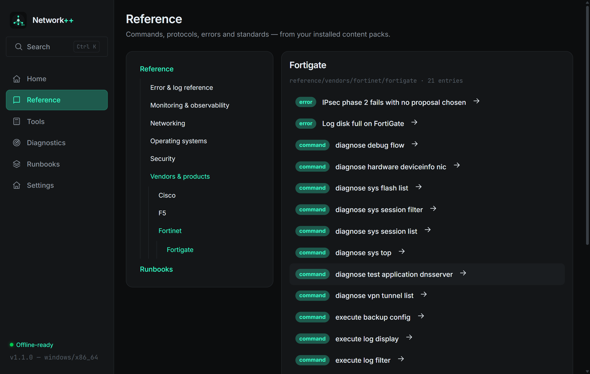

# Network++ 1.1.0 — vendor-first Reference taxonomy

**Date:** 2026-11-07 · **Tag:** `v1.1.0`

Navigation restructure requested by the maintainer: vendor products now live
under their company in Reference, instead of being scattered across
type-level branches.

## Taxonomy change

```
Before:  reference/firewalls/fortigate · reference/security/fortiauthenticator · reference/devices/f5-bigip
After:   reference/vendors/fortinet/fortigate · reference/vendors/fortinet/fortiweb · reference/vendors/f5/bigip
```

- **Vendor product packs** → `reference/vendors/<company>/<product>/…`
  (all Fortinet products nest under one Fortinet node; Cisco → asa; F5 → bigip;
  Juniper, MikroTik, Palo Alto, pfSense/OPNsense, Check Point, Sophos,
  Proxmox, Docker, Kubernetes, AWS, Azure, Google Cloud likewise)
- **Knowledge packs stay domain-first**: Security+ / ISO/IEC / WAF concepts
  under `reference/security/…`, Splunk operations under
  `reference/monitoring/…`, fundamentals/errors under their roots
- Reference tree gains the **"Vendors & products"** branch; vendor error
  entities nest inside their vendor node

## Pack format

- `manifest.json` may now declare `"categories": [...]` — the taxonomy roots
  the pack contributes to, surfaced in the registry index per pack
  (PACK-SPEC updated; field is optional, format stays spec v1)
- All vendor packs re-released as **1.1.0** with migrated categories

## Registry

- `index.json` entries now include `categories`
- End-to-end verified: real registry zips installed through the app's
  install-from-file path (82 entities across 4 packs), parsed, indexed and
  browsable in the vendor tree

## Verification

| Check | Result |
|---|---|
| Rust tests | 94/94 |
| Registry zips installed via app | 4 packs / 82 entities |
| Vendor tree browsing | Fortinet → Fortigate live capture |


