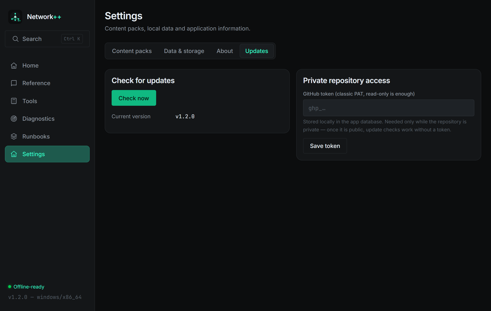

# Network++ 1.2.0 — updates, factory reset, license verified

**Date:** 2026-11-07 · **Tag:** `v1.2.0`

## New: in-app update checker (`Settings → Updates`)

- **Check now** queries the GitHub releases API, compares semver against the
  running version and shows the latest release with notes
- **Download & install**: pulls the official `_x64-setup.exe` to a temp
  folder, launches the installer wizard and closes the app — one click from
  "check" to "updating"
- **Private-repo support**: a GitHub token (classic PAT, read-only) can be
  stored locally until the repository goes public; without it the check
  explains exactly what's missing
- Trust boundary: the installer executor hard-allowlists download URLs from
  this repository's releases only (`…/IzumiRain/Network_PP/releases/download/…`
  + `.exe`) — the command can never be used to fetch and run anything else

## New: Reset application data (`Settings → Data & storage`)

- Two-step destructive confirmation, then wipes **everything**: settings,
  favorites, pins, history, sessions, runbook progress, all installed packs
- Reinstalls the core pack automatically, no restart needed
- Unit-tested wipe (95/95 tests)

## Uninstaller

Ships with the installer (NSIS): **Windows Settings → Apps → Network++ →
Uninstall** (or `uninstall.exe` in the install folder). Verified registered
under `HKCU\…\Uninstall\Network++`.

## License text corrected to verbatim

The LICENSE file previously paraphrased the PolyForm text. It now embeds
**the official PolyForm Noncommercial 1.0.0 text verbatim** from the SPDX
license list — section-by-section diffed, including the correctly named
`Patent Defense` and `No Liability` sections that the paraphrase had
altered — followed by the maintainer's Additional Terms (lawful use only).

## Verification

| Check | Result |
|---|---|
| Rust tests | 95/95 (factory-reset wipe test added) |
| Clippy | 0 warnings |
| Updates tab + reset flow | live-captured from the real app |

